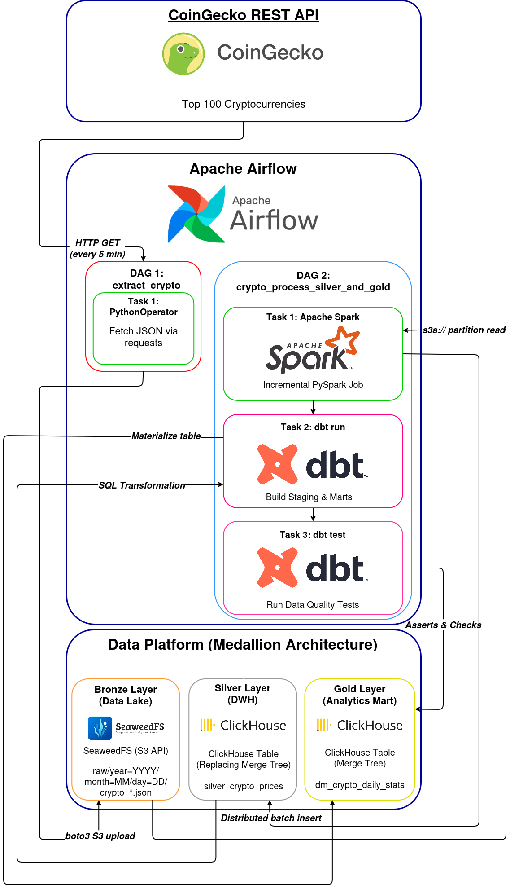

# 🚀 End-to-End Crypto Analytics Pipeline (ETL)

[](https://airflow.apache.org/)
[](https://spark.apache.org/)
[](https://clickhouse.com/)
[](https://www.getdbt.com/)
[-green)](https://github.com/seaweedfs/seaweedfs)
[](https://www.docker.com/)

A production-grade batch pipeline for near-real-time ingestion, cleaning, dimensional modeling, and testing of cryptocurrency prices and market caps. Designed following the industry-standard **Medallion Architecture (Bronze -> Silver -> Gold)**.

---

## 🏛 Solution Architecture

<div align="center">
    
</div>

1. **Extract (Bronze Layer):** 
   An Airflow DAG running every 5 minutes fetches price and market cap metrics for the top 100 cryptocurrencies via the **CoinGecko REST API** and stores raw partitioned `JSON` objects in an S3-compatible Data Lake powered by **SeaweedFS**.
2. **Transform (Silver Layer):** 
   An hourly **Apache Spark (PySpark)** batch job reads incremental partitions from S3 (using date-based partition pruning), flattens complex nested JSON maps, enforces strict financial precision (preventing floating-point inaccuracies), and writes data in parallel micro-batches into **ClickHouse** (`ReplacingMergeTree`).
3. **Model & Quality (Gold Layer):** 
   **dbt (Data Build Tool)** builds analytics marts, calculates daily volatility and price dynamics, and enforces automated Data Quality Tests before publishing marts to production.

---

## 📊 Data Models (dbt)

* **`stg_crypto_prices` (Staging, View):** Reads raw ClickHouse tables, deduplicates records via `FINAL`, and filters out invalid records.
* **`dm_crypto_daily_stats` (Marts, Table):** Business-ready analytical mart containing daily aggregated metrics:
  * `min_price_usd`, `max_price_usd`, `avg_price_usd`
  * `latest_market_cap_usd` (utilizing ClickHouse's optimized `argMax` aggregate function)
  * `volatility_pct` — daily percentage price volatility
  * `ticks_count` — total number of price snapshots captured per day

---

## 🛠 Tech Stack

* **Orchestration:** Apache Airflow 2.8.3 (CeleryExecutor, PostgreSQL, Redis)
* **Data Lake:** SeaweedFS (Full AWS S3 API compatibility)
* **Data Processing:** Apache Spark 3.5.1 (PySpark)
* **Data Warehouse (DWH):** ClickHouse 24.3
* **Transformation & Data Quality:** dbt-core & dbt-clickhouse 1.8.4
* **Environment & Package Management:** `uv` (Python package installer), Docker Compose

---

## 🚀 Quick Start

### 1. Clone the repository
```bash
git clone https://github.com/NikolayRom/ETL_CoinGecko.git
cd ETL_CoinGecko
```

### 2. Configure Environment Variables

Create your .env configuration file from the template:

```bash
cp .env.ex .env
```
(Make sure to specify your COINGECKO_API_KEY inside .env).

### 3. Build & Run Infrastructure

Build the custom Airflow image (bundled with Java 17, Spark, uv, and dbt) and spin up all containerized services:

```bash
docker compose up -d
```

### 4. Service Endpoints:

- Airflow UI: http://localhost:8080 (Login: admin, Password: admin)

- SeaweedFS S3 Admin UI: http://localhost:23646 (Login: admin, Password: admin)

- ClickHouse HTTP: http://localhost:8123

## 🧪 Manual dbt Execution & Testing

To manually trigger dbt models compilation or run data quality assertions:

```bash
docker compose exec airflow-worker bash -c "cd /opt/airflow/dbt && /opt/dbt-venv/bin/dbt run --profiles-dir ."
docker compose exec airflow-worker bash -c "cd /opt/airflow/dbt && /opt/dbt-venv/bin/dbt test --profiles-dir ."
```

## 💡 Key Engineering Decisions & Highlights

- Preventing Spark Driver OOM (Out Of Memory):
Strictly avoided DataFrame.collect(). Bulk database writes are executed distributedly across workers using rdd.foreachPartition() with connection reuse and micro-batching.

- Idempotency & Partition Pruning:
Spark reads only the required partition based on the execution date ({{ ds }}). Re-running backfills or failed tasks is entirely idempotent thanks to ClickHouse's ReplacingMergeTree() engine.

- Environment Isolation for dbt & Airflow:
To eliminate hard dependency conflicts (such as overlapping urllib3 and pydantic versions), dbt is isolated into its own dedicated virtualenv (/opt/dbt-venv) within the Airflow image using the uv package manager.

- Strict Financial Arithmetic:
All cryptocurrency values, prices, and capitalizations are handled using Decimal(18, 8) and Decimal(20, 2) types rather than standard Float to guarantee precision up to 1 Satoshi.